# Segundo Cérebro: Computação de Alto Desempenho (HPC)

Um notebook no **Gemini Notebook** (antigo NotebookLM) que funciona como um especialista em Computação de Alto
Desempenho. Ele responde **apenas** com base nas fontes que eu selecionei, mostra de qual fonte veio cada
resposta e gera materiais de estudo a partir delas.

🔗 **Notebook compartilhado:** https://notebook.google.com/notebook/190b11ea-ab61-4d0a-8beb-e0e373d94062

## Tema e objetivo

> Montar um segundo cérebro que me ensine os fundamentos de Computação de Alto Desempenho (paralelismo com
> MPI, OpenMP e CUDA, e os limites de desempenho) e me ajude a revisar para provas e entrevistas.

Escolhi o tema porque ele faz parte da minha graduação em Ciência da Computação. Antes de montar o notebook,
eu tinha acabado de estudar o assunto em um curso, então consegui julgar a qualidade das fontes e das respostas.

## Fontes

São 9 fontes em dois formatos (texto e vídeo). Todas estão em inglês, e o notebook responde em português.
Isso também testa uma das ideias de evolução do desafio: usar fontes em outra língua.


### Textos

| Fonte | Por que confio |
|---|---|
| [LLNL: Introduction to Parallel Computing Tutorial](https://hpc.llnl.gov/documentation/tutorials/introduction-parallel-computing-tutorial) | Laboratório nacional dos EUA (Lawrence Livermore) que opera alguns dos maiores supercomputadores do mundo. É um tutorial clássico, usado em cursos de HPC. |
| [LLNL: Message Passing Interface (MPI)](https://hpc-tutorials.llnl.gov/mpi/) | Mesmo laboratório. Tutorial de referência de MPI. |
| [LLNL: OpenMP](https://hpc-tutorials.llnl.gov/openmp/) | Mesmo laboratório. Tutorial de referência de OpenMP. |
| [NVIDIA: An Even Easier Introduction to CUDA](https://developer.nvidia.com/blog/even-easier-introduction-cuda/) | Escrito pela própria fabricante do CUDA, com código de exemplo. |
| [The Art of HPC (Victor Eijkhout, TACC)](https://theartofhpc.com/) | Livro gratuito de um pesquisador do Texas Advanced Computing Center, usado como material de curso. |
| [TOP500](https://top500.org) | Ranking oficial dos supercomputadores, publicado duas vezes por ano. Serve de fonte de dados atuais. |

### Vídeos

Busquei os vídeos em uma aba anônima, para não deixar o algoritmo escolher por mim.

| Vídeo | Canal | Por que entrou |
|---|---|---|
| [Stanford CS149: Parallel Computing, Lecture 1 (Why Parallelism? Why Efficiency?)](https://www.youtube.com/watch?v=V1tINV2-9p4) | Stanford Online | Aula de uma universidade de ponta, base teórica. |
| [How Supercomputers Actually Work: The Secret Language (MPI)](https://www.youtube.com/watch?v=juKnIgue8wI) | Computer Science Simplified | Introdução visual ao MPI, complementa o tutorial da LLNL. |
| [Nvidia CUDA Explained in 6 Minutes](https://www.youtube.com/watch?v=yMNlAy6X4pg) | Bug Labs | Resumo curto de CUDA para revisão rápida. |

**Critério de seleção:** só entraram fontes de instituições reconhecidas (laboratório nacional, universidade,
fabricante, ranking oficial) ou vídeos que conferi e que só complementam essas fontes. Dois links que importei
no começo davam erro de página não encontrada e foram trocados pelos endereços atuais.

## Diretriz de comportamento

Configurei o notebook no modo **Personalizado** com esta instrução:

> Comporte-se como um professor especialista em Computação de Alto Desempenho. Responda em português, de forma
> didática, usando apenas as fontes do notebook e sempre indicando de qual fonte veio cada informação. Quando as
> fontes não cobrirem a pergunta, diga isso em vez de inventar.


## Perguntas, respostas e fontes

Em cada pergunta, abri as citações para conferir de onde veio a resposta.

### 1. Qual a diferença entre memória compartilhada (OpenMP) e memória distribuída (MPI)?

Na memória compartilhada, todos os processadores acessam o mesmo espaço de memória. Na distribuída, cada
processador tem a sua própria memória, e os dados são trocados por mensagens pela rede.

**Fontes citadas:** tutorial de computação paralela da LLNL e o vídeo sobre MPI.

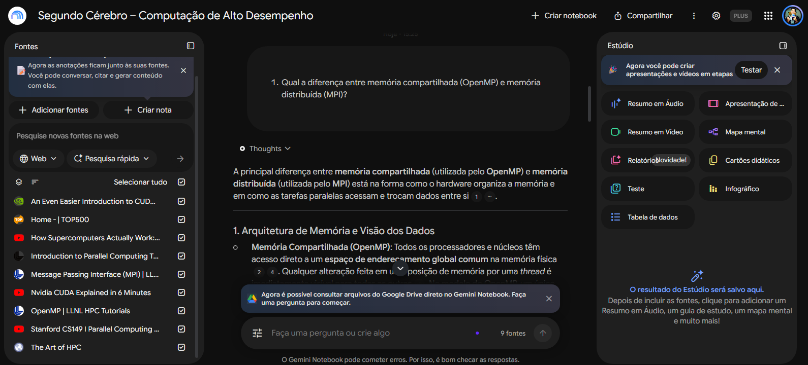
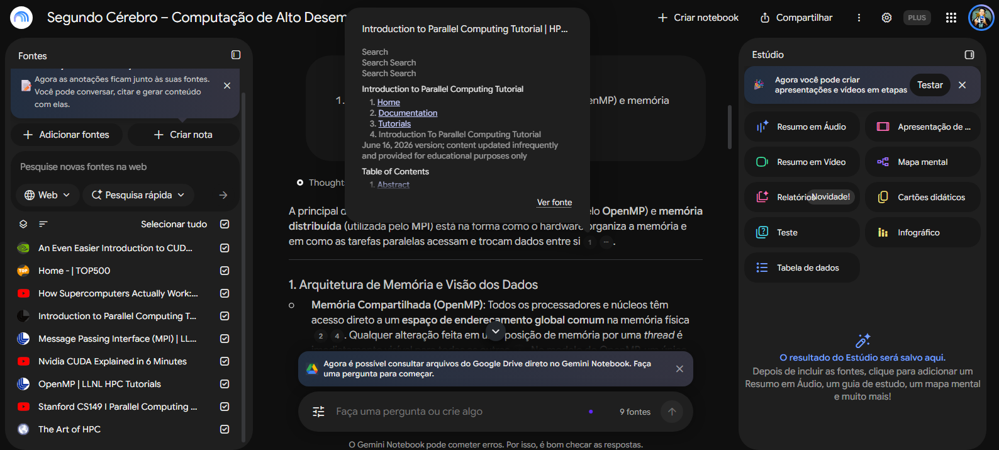
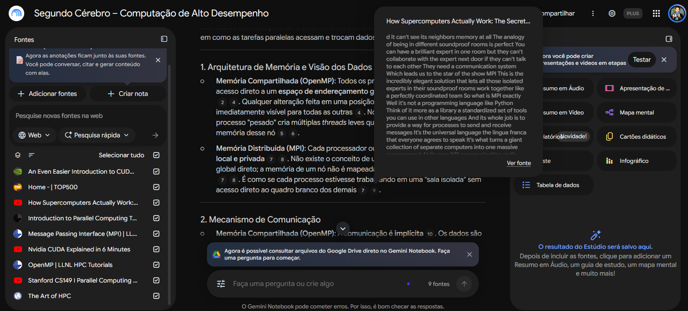

### 2. O que a Lei de Amdahl diz sobre o limite do speedup?

O ganho máximo é limitado pela parte do programa que precisa rodar em sequência: por mais processadores que
se adicionem, essa fração serial impõe um teto à aceleração.

**Fonte citada:** tutorial da LLNL, seção *Amdahl's Law*.

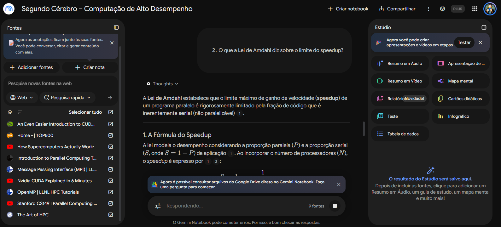
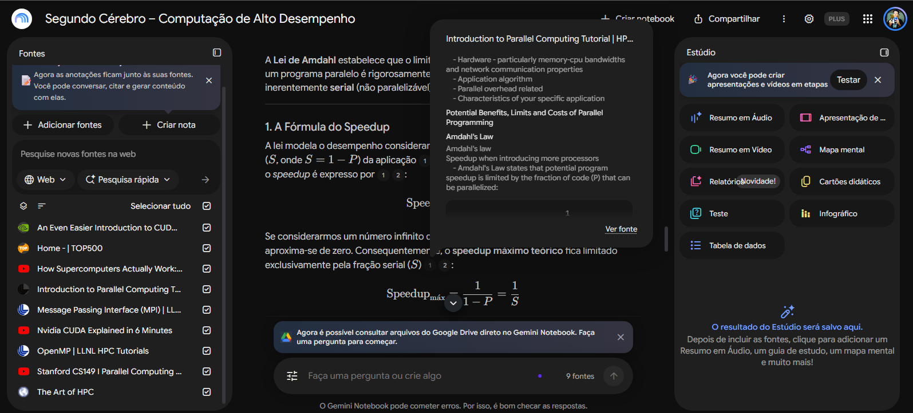

### 3. O que é um kernel em CUDA e como as threads são organizadas?

O kernel é uma função marcada com `__global__` que roda em paralelo na GPU, executada por muitas threads
organizadas em blocos, e os blocos formam um grid.

**Fonte citada:** artigo da NVIDIA (incluindo o trecho de código).

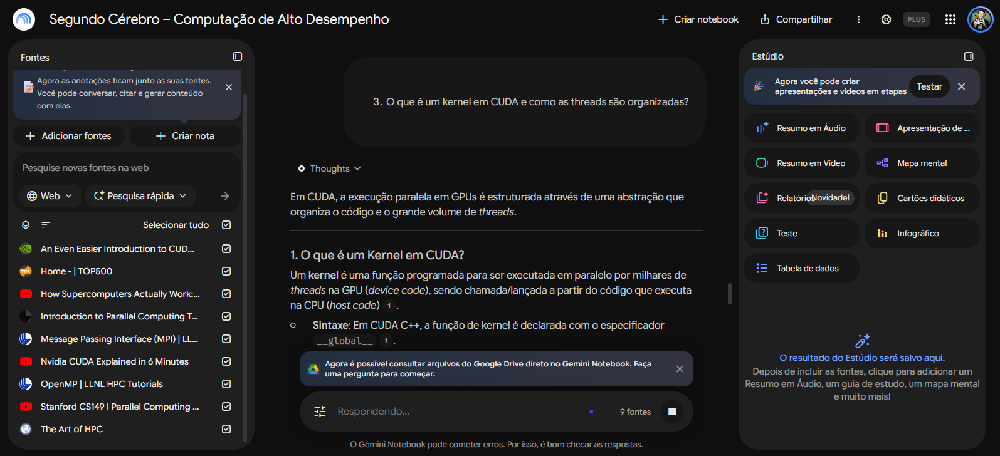
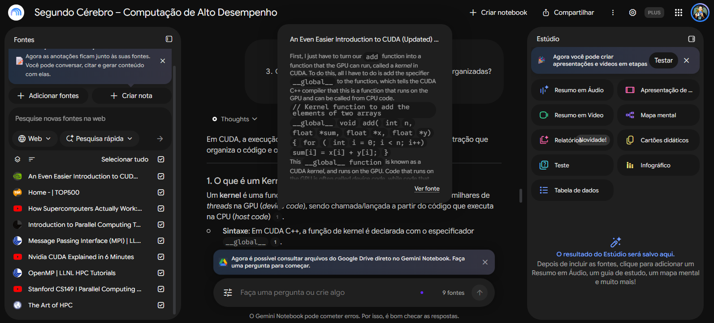

### 4. O que é false sharing e como evitar? (a pergunta-teste)

**O notebook avisou que o assunto não está nas fontes**, em vez de inventar uma resposta. Ele apontou só os
conceitos próximos que existem no material (memória e acesso não uniforme, da LLNL).

É a prova mais forte de que a diretriz funciona: o notebook responde pelas fontes e admite quando elas não
cobrem a pergunta.

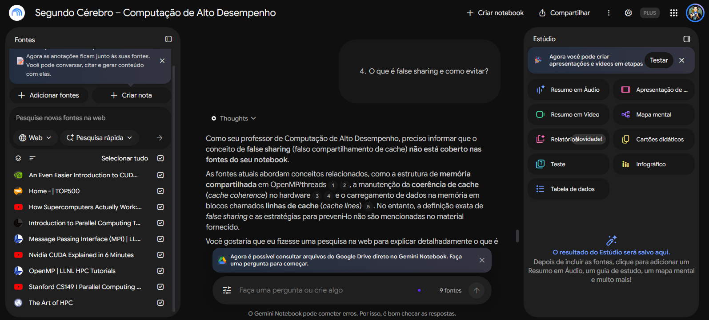
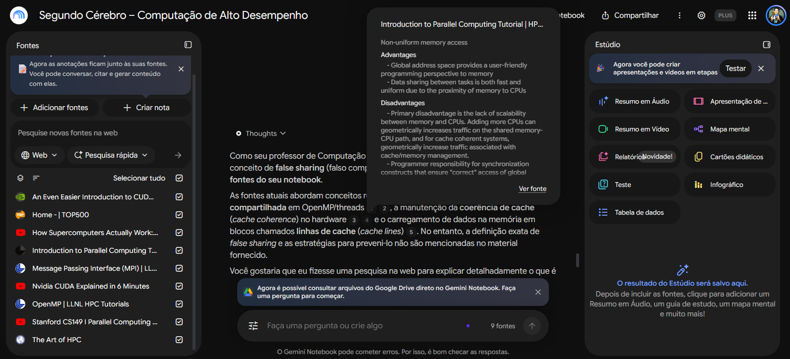

### 5. Quando vale usar GPU em vez de CPU?

A GPU compensa em trabalhos com muito paralelismo de dados (a mesma operação sobre grandes volumes). A CPU
continua melhor para tarefas sequenciais e com muitas decisões.

**Fonte citada:** aula de Stanford CS149.

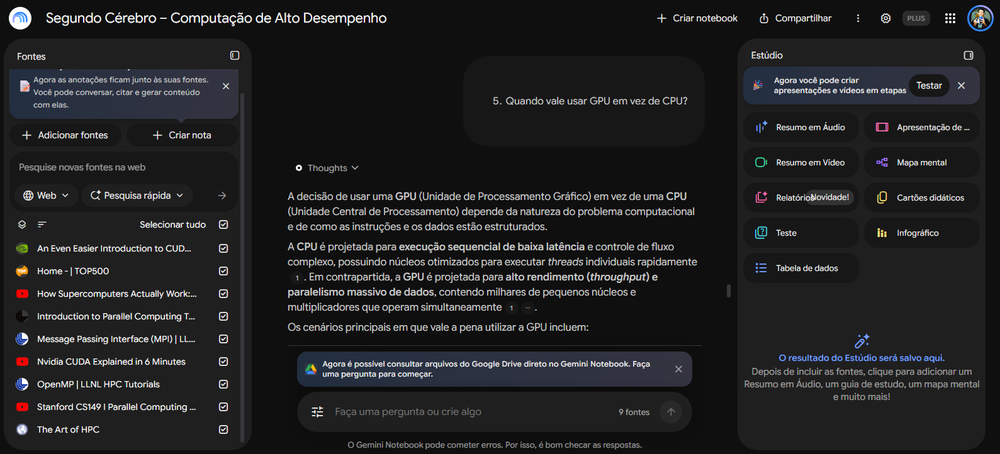
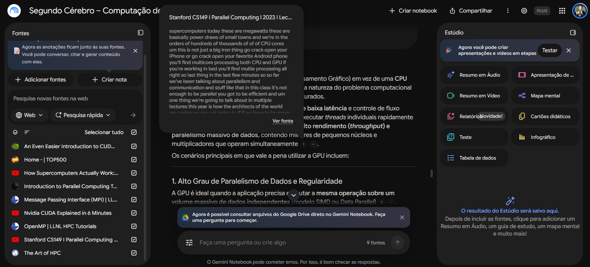

## Materiais gerados no Estúdio

| Material | Arquivo |
|---|---|
| Mapa mental | [materiais/mapa-mental.png](materiais/mapa-mental.png) |
| Apresentação "A Arquitetura da Escala" (15 slides) | [materiais/slides-arquitetura-da-escala.pdf](materiais/slides-arquitetura-da-escala.pdf) |
| Relatório "Masterizando a Computação Paralela" | [materiais/relatorio/](materiais/relatorio/) (7 prints, um por seção) |
| Quiz "Supercomputação" (12 perguntas) | [materiais/quiz/](materiais/quiz/) |

### Mapa mental

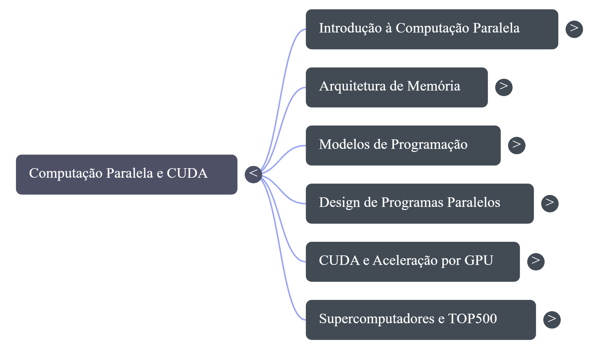

### Slides (visão geral)

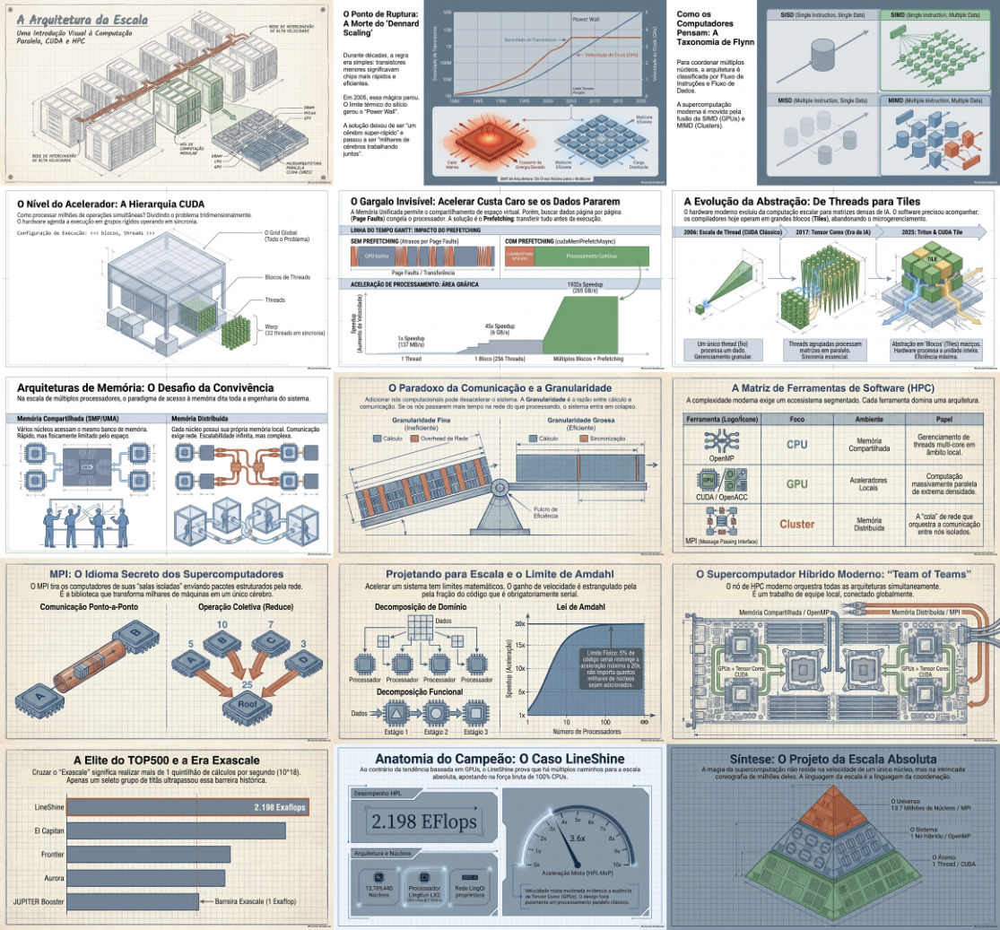

## O que aprendi com o processo

- **A escolha das fontes define a qualidade do notebook.** Poucas fontes confiáveis foram suficientes para
  gerar relatório, slides e quiz consistentes.
- **Sempre conferir as citações.** Clicar no número da citação mostra o trecho exato da fonte e permite
  validar cada resposta.
- **Uma pergunta fora do escopo é um bom teste.** A pergunta 4 mostrou que o notebook não inventa quando
  recebe uma diretriz clara.
- **Fontes em inglês, respostas em português** funcionaram bem, sem perder precisão.

## Estrutura

```
prints/      fontes, diretriz e as 5 perguntas com as citações
materiais/   mapa mental, slides (PDF), relatório e quiz
```
